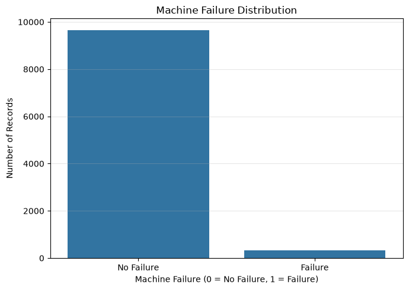
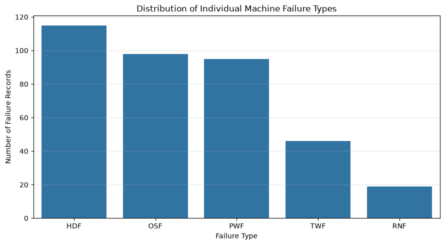
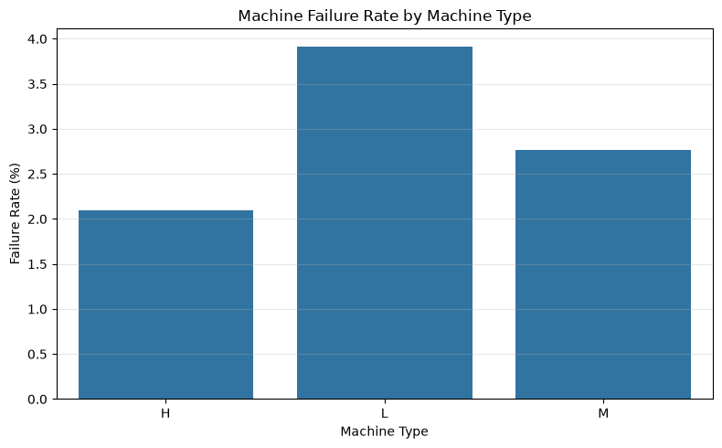
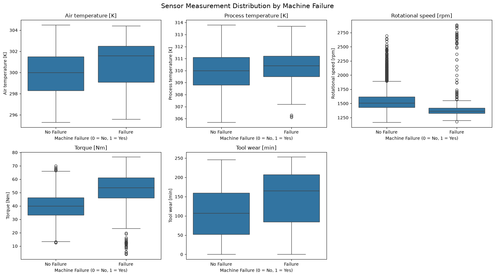
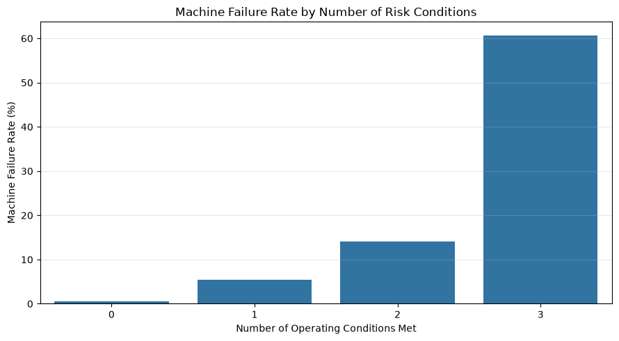
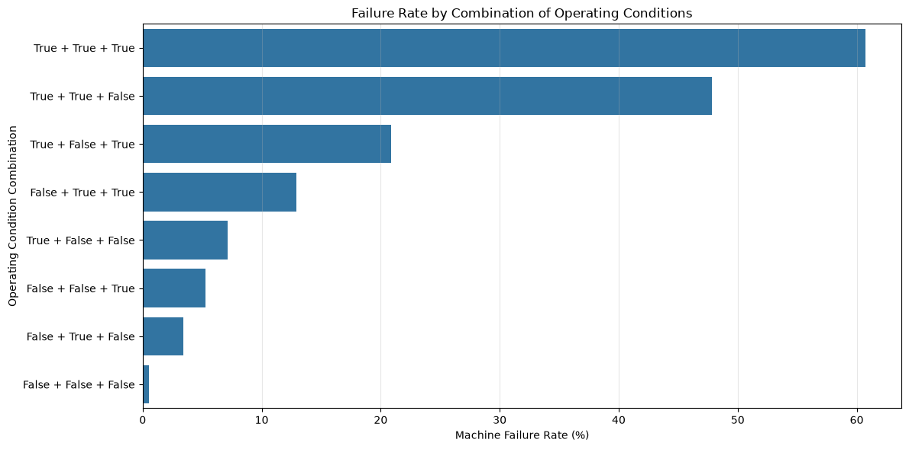
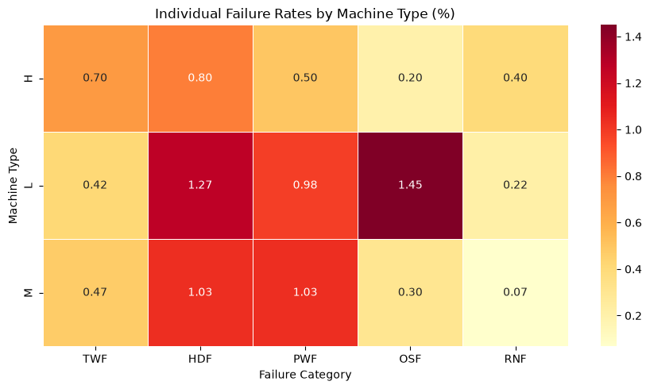
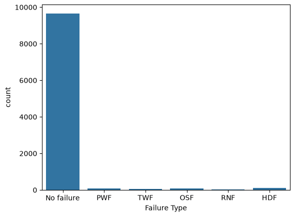
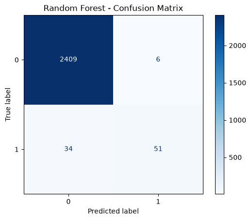
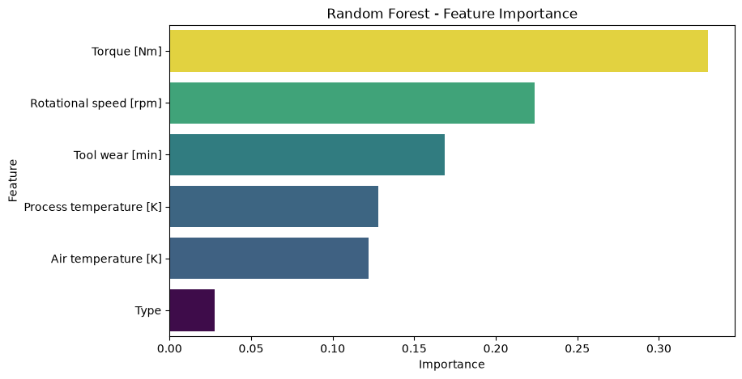

# Predictive Maintenance and Manufacturing Reliability Intelligence

**From machine sensor signals to maintenance prioritisation decisions.**

A manufacturing reliability project combining operational data analysis and machine learning to investigate equipment failures, understand sensor-related risk patterns and identify opportunities for more targeted maintenance inspections.

---

## The Maintenance Challenge

Unexpected machine failures can interrupt production, increase maintenance costs and affect operational efficiency.

The practical challenge is not simply identifying whether a machine has failed. It is understanding:

- Which operating conditions are associated with higher failure rates?
- Do different machine types exhibit different reliability patterns?
- Which sensor measurements contribute most to failure predictions?
- Can machine failure alerts help maintenance teams prioritise inspections?

This project approaches these questions through two complementary investigations: reliability intelligence and predictive modelling.

## Project at a Glance

| Dimension | Details |
|---|---|
| Dataset | AI4I 2020 Predictive Maintenance |
| Observations | 10,000 |
| Variables | 14 original columns |
| Machine types | L, M and H |
| Failure records | 339 |
| Overall failure rate | 3.39% |
| Predictive models | Logistic Regression, Random Forest |
| Primary evaluation focus | Failure-class precision, recall and F1-score |

## Investigation 01: Understanding Equipment Reliability

The first notebook investigates the operational characteristics associated with machine failures.

### What was examined?

- Overall machine failure distribution
- Individual failure categories: TWF, HDF, PWF, OSF and RNF
- Failure rates across machine types
- Air and process temperature
- Rotational speed, torque and tool wear
- Individual and combined operating-condition risks
- Maintenance prioritisation opportunities

### Evidence from the analysis

**1. Failure categories**

Heat Dissipation Failure (HDF) was the most frequently recorded individual failure category, with 115 records. Overstrain Failure (OSF) accounted for 98, Power Failure (PWF) for 95, Tool Wear Failure (TWF) for 46 and Random Failure (RNF) for 19.

*Failure indicators can overlap, so these counts do not represent mutually exclusive machine failures.*

**2. Reliability differs by machine type**

| Machine Type | Observed Failure Rate |
|---|---:|
| L | 3.92% |
| M | 2.77% |
| H | 2.09% |

Type L recorded the highest overall failure rate in this dataset.

**3. Operating conditions and failure risk**

Three conditions were selected for exploratory investigation:

- Tool wear above 200 minutes
- Torque above 50 Nm
- Rotational speed between 1,200 and 1,400 rpm

| Operating Condition | Observed Failure Rate |
|---|---:|
| High tool wear | 15.49% |
| High torque | 13.69% |
| Selected rotational speed range | 12.65% |

**4. Combined operating conditions**

The combination of all three selected conditions recorded 51 failures across 84 observations, an observed failure rate of **60.71%**.

By comparison, observations meeting none of these selected conditions had a 0.52% failure rate.

This suggests that examining combinations of sensor conditions may provide more useful investigation priorities than considering individual measurements in isolation.

These are exploratory associations based on the available records, not validated engineering thresholds.

## Investigation 02: Predicting Machine Failures

The second notebook develops classification models using machine operating and sensor measurements.

### Model inputs

Six features were used:

- Machine type
- Air temperature
- Process temperature
- Rotational speed
- Torque
- Tool wear

The target variable was `Machine failure`.

The dataset was divided into training and testing sets using a stratified 75:25 split.

### Model comparison

| Metric | Logistic Regression | Random Forest |
|---|---:|---:|
| Accuracy | 96.76% | 98.40% |
| Failure Precision | 60% | 89% |
| Failure Recall | 14% | 60% |
| Failure F1-score | 0.23 | 0.72 |

Random Forest performed better across the reported failure-class metrics.

**Why recall matters:** A model that misses actual equipment failures may provide limited value to a maintenance team, even when its overall accuracy is high.

The Random Forest model identified 51 of the 85 failure cases in the test set, while missing 34. It also generated 6 false failure alerts.

This demonstrates both the potential and the limitations of the model.

### What influenced the Random Forest predictions?

| Feature | Importance |
|---|---:|
| Torque | 0.3299 |
| Rotational speed | 0.2241 |
| Tool wear | 0.1685 |
| Process temperature | 0.1279 |
| Air temperature | 0.1220 |
| Machine type | 0.0277 |

Torque had the highest feature importance, followed by rotational speed and tool wear.

Feature importance describes the model's use of these variables; it does not establish that they cause machine failures.

## Visual Evidence

The following figures are extracted from the two project notebooks.

### Reliability and Failure Analysis

### Maintenance Risk Analysis

### Predictive Model Evaluation

## What the Findings Mean for Maintenance Planning

The analysis suggests several areas for further operational investigation:

1. **Prioritise equipment inspections:** Investigate machines exhibiting multiple unusual operating conditions.
2. **Monitor tool wear:** Review machines with accumulated tool wear above the exploratory threshold.
3. **Investigate torque and speed:** Examine combinations associated with higher observed failure rates.
4. **Consider machine-specific reliability:** Type L machines showed a higher failure rate in this dataset.
5. **Evaluate predictive alerts carefully:** Random Forest achieved stronger failure detection metrics than Logistic Regression, but its 60% recall means further improvement is necessary before operational use.

## Limitations and Further Work

- Machine failures represent only 3.39% of the dataset, creating class imbalance.
- The business analysis identified 27 mismatches between the overall machine failure label and individual failure indicators.
- The selected operating-condition thresholds are exploratory and require engineering validation.
- Some combined risk groups contain relatively few observations.
- The Random Forest model missed 34 actual failure cases in the test set.
- The dataset does not establish whether maintenance interventions would prevent failures.
- Further work should explore threshold optimisation, class-imbalance handling, cost-sensitive evaluation and validation on additional operational data.

## Repository Contents

| File | Purpose |
|---|---|
| [Predictive_Maintenance_Business_Intelligence.ipynb](./Predictive_Maintenance_Business_Intelligence.ipynb) | Reliability analysis, sensor investigations, operating-condition risk and maintenance recommendations |
| [Predictive%20Maintenance%20with%20ML.ipynb](./Predictive%20Maintenance%20with%20ML.ipynb) | Feature preparation, Logistic Regression, Random Forest, model evaluation and feature importance |
| [images/](./images/) | Extracted project visualisations |

## Running the Notebooks

1. Clone or download this repository.
2. Install the required Python libraries: `pandas`, `numpy`, `matplotlib`, `seaborn`, `scikit-learn` and `eli5`.
3. Obtain the AI4I 2020 Predictive Maintenance dataset.
4. Place `ai4i2020.csv` in the same working directory as the notebooks.
5. Open the notebooks in Jupyter Notebook.
6. Run the cells in sequence.

---

*This project demonstrates how manufacturing data analysis and predictive modelling can work together to support evidence-based equipment reliability investigations and maintenance planning.*
